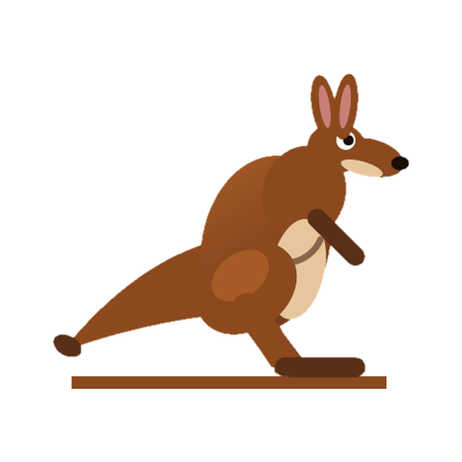

<p align="center"></p>

# KanguRun

Tek dosyalık, bağımlılıksız HTML5 Canvas kanguru koşu oyunu. 10 dil (TR, EN, ES, FR, DE, IT, PT-BR, AR, RU, ZH), otomatik açık/koyu tema ve çevrimdışı çalışan PWA desteği.

**Kontroller:** `Boşluk` / `↑` / dokunma = zıpla · `P` = duraklat

## Yerelde çalıştırma

Service worker için `file://` değil, bir yerel sunucu gerekir:

```bash
python -m http.server 8080   # http://localhost:8080
```

## Yayınlama

- **GitHub Pages:** `Settings → Pages → Deploy from a branch → main / (root)`
- **Cloudflare Pages:** Framework: None, build command: boş, output directory: `/`
- **Netlify:** Repoyu bağla; `netlify.toml` yapılandırmayı otomatik alır.

`_headers` Cloudflare Pages ve Netlify'da uygulanır; GitHub Pages bu dosyayı yok sayar.

## Telefona yükleme (PWA)

- **Android / Chrome:** menü → *Ana ekrana ekle* / *Uygulamayı yükle*
- **iOS / Safari:** Paylaş → *Ana Ekrana Ekle*

## Yeni sürüm yayınlama

`sw.js` içindeki `VERSION` değerini artır ve yayınla. Kullanıcılarda yeni önbellek otomatik kurulur, eskisi silinir.

## Dosyalar

```
index.html · manifest.webmanifest · sw.js · _headers · netlify.toml
.nojekyll · LICENSE · README.md · icons/ (192, 512, apple-touch-icon)
```

## Lisans

[MIT](LICENSE) © 2026 A. Emre Canaslan
